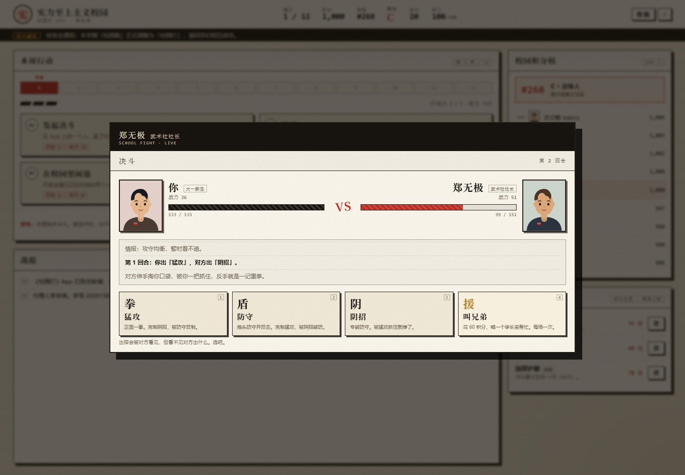

# 实力至上主义校园 · 《校园打》

> 在线玩：**https://remember1314.github.io/elite-campus/**

按 B 站 UP 主「阿玉老贼」的视频《欢迎来到实力至上主义校园》（<https://www.bilibili.com/video/BV1nx4n6cEst/>）改编的回合制网页游戏。
12 周积分决斗，赢家扫走输家的分，学年第一去打校长副本。

## 玩法

- 一学年 12 周，每周 3 点行动力；每周必须打一场，不主动打会被系统随机匹配，不能拒绝。
- 战斗三招相克：猛攻克阴招、阴招克防守、防守克猛攻；键盘 `1` `2` `3` `4` 也能出招。
- 积分 = 名次 = 校内待遇（食堂、图书馆、等级称号 S/A/B/C/D）。
- 第 5、10 周强制军团战；被高手挑战时可花积分雇人代打。
- 学年结算第一名挑战校长 + 全体体育老师，全胜解锁「校长办公室」结局，共 6 种结局。

## 关于这个仓库

整个游戏是**一个 `index.html`**（CSS / JS 全部内联，零外部依赖，手机竖屏可玩），
由本地源码用脚本打包而来，本仓库只放打包产物，方便 GitHub Pages 直接托管。

- 修改游戏：改源码 → 重新打包 → 替换 `index.html` → 提交。
- `poster.png`：B 站评论区用的二维码海报（扫码即玩）。
- `poster.py` / `publish.ps1`：生成海报、发布用的脚本，与游戏运行无关。

纯属虚构，与任何真实学校、真实 App 以及达尔文先生无关。改编自 B 站视频，非官方作品。
